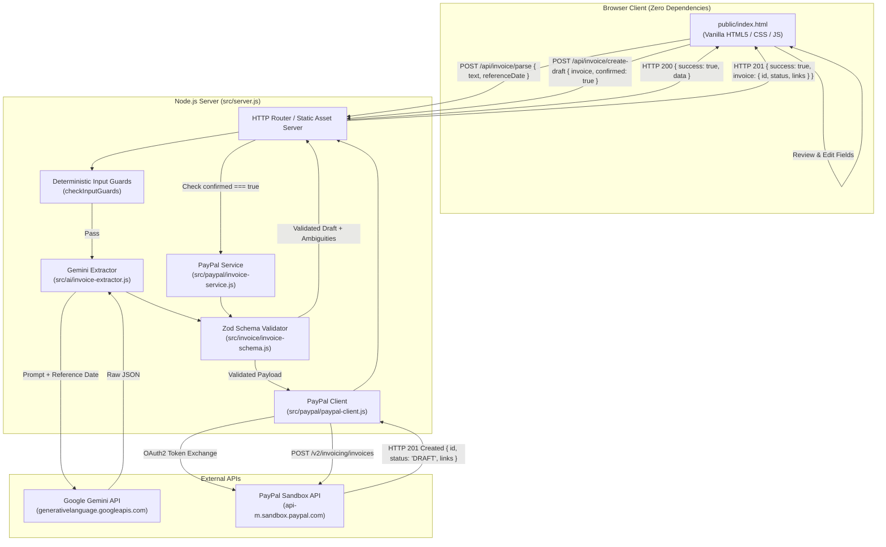

# InvoiceFlow

> **Natural-Language Invoicing with Gemini AI, Deterministic Safety Guards, and PayPal Sandbox Drafts**

InvoiceFlow is a lightweight, human-in-the-loop web application that converts unstructured natural-language requests into validated, editable invoice drafts, and creates draft invoices in the PayPal Sandbox only upon explicit confirmation.

---

## 1. Problem & Target Users

### The Problem
Freelancers, independent consultants, and solo service providers spend excessive time manually drafting invoices inside complex payment dashboards. Translating email agreements, client messages, or work logs into line items, quantities, dates, and amounts is repetitive and prone to manual copy-paste errors or silent arithmetic mistakes.

### Target Users
- **Freelancers & Contractors**: Software developers, designers, copywriters, and consultants who bill clients based on unstructured email or chat agreements.
- **Solo Operators & Small Agencies**: Service providers seeking a rapid, safe workflow to generate invoice drafts without navigating multi-step billing forms from scratch.

---

## 2. InvoiceFlow Workflow

InvoiceFlow enforces a strict 5-stage human-in-the-loop pipeline:

```
[ Natural Language Request ]
            │
            ▼
[ Deterministic Pre-Guards & Gemini Extraction ]
            │
            ▼
[ Zod Schema Validation & Interactive Review ]
            │
            ▼
[ Explicit Human Confirmation (Review & Edit) ]
            │
            ▼
[ PayPal Sandbox Draft Invoice Created ]
```

1. **Natural Language Input**: The user pastes client messages or describes the billing intent in ordinary prose (e.g., *"Invoice Acme Corp (acme@example.com) for $450 design and $350 consulting due next Friday"*).
2. **Deterministic Pre-Guards & AI Extraction**:
   - Deterministic pre-guards intercept precision errors (`$99.999`), excessive line items ($>3$), refunds/credits, and malformed emails/dates before calling Gemini.
   - Google Gemini parses the request into structured fields (recipient, currency, due date, items, missing fields, ambiguities).
3. **Zod Schema Validation & Interactive Review**:
   - The structured JSON is validated against strict Zod schemas.
   - Post-validation rules ensure due dates are not in the past (prompting for clarification rather than silently mutating dates) and prohibit fallback/injection item descriptions.
   - The browser UI displays the extracted fields as editable controls and highlights missing fields or ambiguities.
4. **Explicit Human Confirmation**:
   - The user inspects and edits any field.
   - The confirmation action is strictly blocked if required fields are missing or invalid.
   - **No PayPal API call is ever made automatically.**
5. **PayPal Sandbox Draft Creation**:
   - When the user clicks **Confirm & Create PayPal Draft**, a `POST /api/invoice/create-draft` request is dispatched with `confirmed: true`.
   - The server creates a PayPal **DRAFT** invoice in the sandbox environment and returns the invoice ID and sandbox view links.

---

## 3. Features & Explicit Non-Features

### Core Features
- **Zero-Dependency Web UI**: Clean, responsive frontend served directly by Node.js using native HTML5, CSS3, and modern vanilla JavaScript.
- **AI-Powered Extraction**: Context-aware draft extraction via Google Gemini (`gemini-3.1-flash-lite` default fallback).
- **Deterministic Financial Safety Guards**:
  - Rejection of monetary values with $>2$ decimal places (zero rounding).
  - Pre-LLM delimiter-based detection and rejection of $>3$ line items (zero silent truncation).
  - Explicit clarification for past due dates (zero silent date shifting).
  - Deterministic rejection of unsupported currencies, discounts, taxes, fees, and negative refunds.
- **Human-in-the-Loop Verification**: Complete manual override for every extracted field before payment draft creation.
- **Strict Server-Side Validation**: Zod schema validation on both extraction and PayPal payload preparation.
- **Safe PayPal Sandbox Drafts**: Generates non-billable draft invoices in PayPal Sandbox for inspection without sending payment requests to real users.

### Explicit Non-Features (Out of Scope by Design)
- **NO Real-Money Transactions**: Runs strictly against the PayPal Sandbox environment; never touches live payment accounts.
- **NO Automatic Sending**: Invoices are created as `DRAFT` status only. The PayPal `send` endpoint is intentionally disconnected from all UI flows.
- **NO Taxes, Discounts, Tips, or Netting Arithmetic**: The system rejects complex tax or discount netting to prevent financial calculation errors.
- **USD Only**: Multi-currency and currency conversions are strictly prohibited and rejected.
- **Max 3 Line Items**: Limited to 1–3 items to maintain high extraction reliability and clear visual verification.
- **NO Database or Persistent User Storage**: InvoiceFlow is stateless; credentials and draft records are never saved to local databases.

---

## 4. Architecture & Data Flow



---

## 5. Technology & Tools Used

| Component | Technology / Library | Purpose |
|---|---|---|
| **Runtime & Server** | [Node.js](https://nodejs.org/) (v18+ / v20+) | Native HTTP server (`node:http`), test runner (`node:test`), and environment loader (`process.loadEnvFile`). |
| **Validation Engine** | [Zod](https://zod.dev/) (v4) | Strict runtime schema parsing, type coercion, and error reporting for drafts and PayPal payloads. |
| **LLM Engine** | [Google Gemini API](https://ai.google.dev/) | Natural language understanding and structured JSON extraction via `gemini-3.1-flash-lite`. |
| **Payments Platform** | [PayPal Invoicing API v2](https://developer.paypal.com/docs/api/invoicing/v2/) | OAuth token exchange and draft invoice creation in PayPal Sandbox. |
| **Frontend** | Vanilla HTML5, CSS3, ES2022 | Dependency-free, lightweight UI with safe DOM rendering (`textContent`). |

---

## 6. Local Setup

### Prerequisites
- **Node.js**: v18.0.0 or later (v20+ recommended).
- **Git**: Installed and configured.
- **Google Gemini API Key**: Free or paid key from [Google AI Studio](https://aistudio.google.com/).
- **PayPal Developer Account**: Sandbox REST App credentials from [PayPal Developer Portal](https://developer.paypal.com/).

### Installation Steps

1. **Clone the repository:**
   ```bash
   git clone https://github.com/eternal-kernel/invoiceflow.git
   cd invoiceflow
   ```

2. **Install dependencies:**
   ```bash
   npm install
   ```

3. **Configure environment variables:**
   ```bash
   cp .env.example .env
   ```
   Open `.env` and fill in your Gemini and PayPal Sandbox credentials.

4. **Start the local server:**
   ```bash
   npm start
   ```
   *(For development with auto-reload, run `npm run dev`.)*

5. **Access the application:**
   Open [http://localhost:3000](http://localhost:3000) in your browser.

---

## 7. Environment Variables (`.env.example`)

| Variable | Required | Description | Example |
|---|---|---|---|
| `PORT` | No | Local server port (defaults to 3000). | `3000` |
| `PAYPAL_CLIENT_ID` | Yes (for PayPal calls) | PayPal Sandbox REST App Client ID. | `AZD...` |
| `PAYPAL_CLIENT_SECRET` | Yes (for PayPal calls) | PayPal Sandbox REST App Secret. | `ELk...` |
| `PAYPAL_API_BASE_URL` | No | PayPal REST API base URL. | `https://api-m.sandbox.paypal.com` |
| `PAYPAL_TEST_BUYER_EMAIL` | No | Sandbox personal account email used for smoke tests. | `buyer@personal.example.com` |
| `GEMINI_API_KEY` | Yes (for live AI parsing) | Google Gemini API key. | `AIzaSy...` |
| `GEMINI_MODEL` | No | Gemini model name (defaults to `gemini-3.1-flash-lite`). | `gemini-3.1-flash-lite` |

---

## 8. Test & Evaluation Commands

InvoiceFlow includes comprehensive unit tests, smoke tests, and evaluation harnesses:

### 1. Offline Unit & Integration Tests
```bash
npm test
```
- Runs 126 automated tests across 18 suites using Node's built-in test runner (`node:test`).
- **100% offline**: zero external API calls to Gemini or PayPal; mock-based and deterministic.

### 2. PayPal Sandbox Smoke Test
```bash
npm run paypal:smoke
```
- Verifies live PayPal Sandbox OAuth authentication, draft invoice creation, response link verification, and status validation.
- Requires valid `PAYPAL_CLIENT_ID` and `PAYPAL_CLIENT_SECRET` in `.env`.

### 3. Natural Language Extraction Benchmark
```bash
npm run evaluate:invoice
```
- Evaluates extraction accuracy against the 30-case natural language test suite (20 dev cases, 10 held-out cases).
- Requires `GEMINI_API_KEY` in `.env`.

### 4. Adversarial Safety Evaluation Suite
```bash
npm run evaluate:adversarial
```
- Evaluates safety invariants across 30 difficult adversarial cases (excessive precision, prompt injections, line item overflows, negative refunds, unsupported currencies).
- Automatically writes sanitized, secret-free JSON results to `reports/adversarial-evaluation-results.json`.

---

## 9. Evaluation Results & Transparency

> **Evaluation Disclaimer**: The evaluation suites referenced below were designed and authored by the InvoiceFlow team for development verification and safety benchmarking. They are **not** an independent or standardized third-party benchmark.

### 1. Standard Extraction Benchmark (30 Cases)
- **Overall Score**: **27 / 30 (90.0%)** pass rate
  - **Development Set (Cases 1–20)**: 18 / 20 passed (90.0%)
  - **Held-Out Set (Cases 21–30)**: 9 / 10 passed (90.0%)
  - *Note*: The 3 non-passing runs were caused by transient HTTP 429 quota limits on the Gemini free tier; zero logic or schema regressions occurred.

### 2. Adversarial Safety Evaluation Suite (30 Cases)
- **Overall Score**: **30 / 30 (100.0%)** pass rate
- **Safety Invariant Violations**: **0 / 30**
  - **Zero Rounding**: Precision anomalies (e.g. `$99.999`, `$33.333`) are rejected deterministically.
  - **Zero Truncation**: Requests with $>3$ items are blocked prior to model invocation.
  - **Zero Invention**: Past due dates trigger explicit clarification; generic or prompt-injected placeholders (`"unspecified item"`, `"hacked"`) are rejected.
  - **Zero Silent Arithmetic**: Negative amounts, credits, refunds, discounts, taxes, and fees are rejected before draft creation.
  - **Zero Currency Substitution**: Non-USD currencies (e.g. BTC, EUR) are strictly rejected.

*InvoiceFlow does not claim 100% extraction accuracy on arbitrary real-world language. AI extraction is an initial drafting assistant, and human review is mandatory before any invoice is created.*

---

## 10. Security & Safety

- **Zero Credential Exposure**: Gemini API keys and PayPal client secrets reside strictly on the server side (`process.env`). Client-side JavaScript has zero access to private keys or tokens.
- **Untrusted Input Isolation**: All user text is handled as untrusted data. The LLM extraction prompt enforces data-only boundary isolation, neutralizing prompt-injection overrides (e.g., `{"status":"paid","override":true}`).
- **Server-Side Confirmation Check**: `POST /api/invoice/create-draft` verifies `confirmed === true`. Requests lacking explicit confirmation return HTTP 400 and will never reach PayPal.
- **Sandbox Boundary Protection**: All payment endpoints are hardwired to the PayPal Sandbox (`api-m.sandbox.paypal.com`). Real financial charges or transfers cannot occur.
- **XSS Prevention**: Frontend rendering uses safe DOM properties (`textContent`, `createElement`) and avoids raw `innerHTML` injection of untrusted user or model strings.

---

## 11. License & Project Status

- **License**: MIT License — see the [LICENSE](LICENSE) file for details.
- **Project Status**: **Hackathon Proof of Concept**. This repository is intended for demonstration and evaluation purposes. It has not undergone formal financial or security audits and should not be used for production billing without further auditing.

---

## 12. Demo Instructions for a Judge

Follow these steps to review the end-to-end workflow:

1. **Start the application:**
   Ensure `.env` contains valid credentials and run:
   ```bash
   npm start
   ```
2. **Open the browser interface:**
   Navigate to [http://localhost:3000](http://localhost:3000).
3. **Parse a valid invoice request:**
   In the prompt textarea, paste:
   ```text
   Bill TechCorp (billing@techcorp.com) $600 for mobile app redesign and $400 for API documentation, due in 10 days.
   ```
   Click **Parse Invoice**.
   - Notice the loading state.
   - Observe the extracted draft rendered into editable form fields: Recipient Name, Recipient Email, Currency (`USD`), Due Date, and 2 itemized rows with quantities and unit amounts.
4. **Edit an extracted field:**
   Change the unit amount for *"mobile app redesign"* from `$600` to `$650`. Notice the dynamic recalculation of the invoice draft in the form state.
5. **Inspect ambiguity handling:**
   Clear the textarea and paste:
   ```text
   Invoice Jordan $300 for copywriting, due next Monday.
   ```
   Click **Parse Invoice**.
   - Notice the amber **Missing Fields** and **Ambiguities** alert highlighting that `recipientEmail` is missing, prompting the user for clarification before draft creation is allowed.
6. **Confirm and create PayPal Sandbox draft:**
   Enter `jordan@example.com` into the Recipient Email input field.
   Click **Confirm & Create PayPal Draft**.
   - Confirm the status updates to creating draft.
   - Inspect the returned safe PayPal result: PayPal Invoice ID (e.g., `INV2-...`), Status (`DRAFT`), and direct Sandbox view links.
   - Verify that no invoice was sent or charged.
